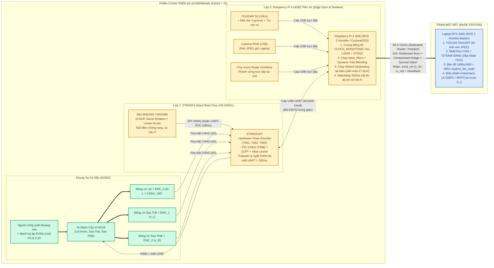
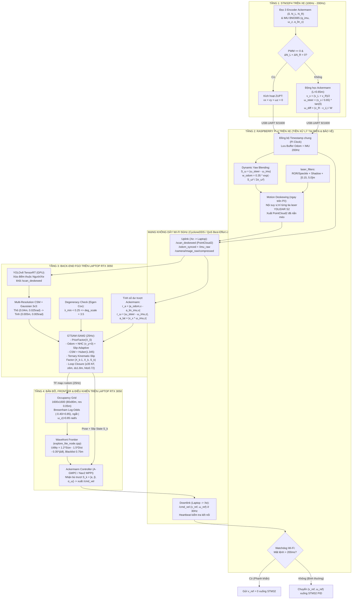

# Kiến Trúc Tối Ưu Hóa (Phiên Bản Không Dây): Xe Tự Hành Ackermann 10 km/h Dùng Raspberry Pi 4 + FGO SLAM (`GTSAM iSAM2`)

> [!NOTE]
> Kiến trúc này giữ nguyên yêu cầu **điều khiển không dây với Raspberry Pi 4 (4GB) đặt trên xe** và **Laptop RTX 3050 đặt ở trạm mặt đất**, đồng thời tối ưu hóa triệt để việc phân tải tính toán, đồng bộ thời gian thực cho `Motion Deskewing` ở $10\text{ km/h}$ ($2.78\text{ m/s}$), và khớp 100% với **khung xe Ackermann 3 Encoder + 3 cầu H `HI216` kế thừa từ [K2022_SYSTEM_ARCHITECTURE.md](./K2022_SYSTEM_ARCHITECTURE.md)**.

---

## 1. Tại Sao Phải Tối Ưu Lại Kiến Trúc 3 Lớp Không Dây Này?

Khi tách Laptop RTX 3050 xuống đất và đặt Raspberry Pi trên xe, có **3 điểm nghẽn chí mạng** ở vận tốc $2.78\text{ m/s}$ ($10\text{ km/h}$) nếu ghép nối theo cách thông thường:
1. **Bỏ ESP32 cầu nối Wi-Fi:** Vì Raspberry Pi đã nằm ngay trên xe cạnh STM32F4, truyền dữ liệu từ STM32 qua ESP32 (Wi-Fi) rồi mới tới Pi/Laptop sẽ gây trễ ngẫu nhiên ($5-80\text{ ms}$) và rớt gói. Thay vào đó, **nối dây trực tiếp `STM32F4 <--USB-UART 921600 baud--> Raspberry Pi`** (bỏ hẳn ESP32).
2. **Đưa `Motion Deskewing` xuống chạy ngay trên Raspberry Pi:** Nếu gửi `LaserScan` thô và `IMU/Odom` qua Wi-Fi về Laptop rồi Laptop mới gỡ méo, độ trễ Wi-Fi lệch nhau giữa 2 luồng sẽ làm sai lệch vị trí tia laser tới vài chục cm. Vì cả `YDLIDAR S2` lẫn `STM32 (3 Encoder + IMU BNO085)` đều cắm dây thẳng vào Pi, **Raspberry Pi giữ chung 1 đồng hồ hệ thống (`CLOCK_MONOTONIC`)** nên phải chạy `laser_filters` + `Motion Deskewing` ngay tại chỗ, rồi mới bắn đám mây điểm đã nắn thẳng qua Wi-Fi 5GHz về Laptop!
3. **Watchdog phanh khẩn cấp $200\text{ ms}$ ngay trên Pi & STM32:** Ở tốc độ $2.78\text{ m/s}$, chỉ cần mất sóng Wi-Fi $0.5\text{ s}$ là xe đã trôi đi $1.4\text{ m}$. Raspberry Pi và STM32 bắt buộc phải có bộ đếm Watchdog độc lập: quá $200\text{ ms}$ không nhận được nhịp tim (`/cmd_vel` / Heartbeat) từ Laptop thì tự động phanh dừng xe (`v_ref = 0`).

---

## 2. Sơ Đồ 1: Kiến Trúc Phần Cứng 3 Lớp Không Dây Đã Tối Ưu Hóa

---

## 3. Sơ Đồ 2: Phân Tải Thuật Toán 4 Tầng Trên Kiến Trúc Không Dây (Pi $\leftrightarrow$ Laptop RTX 3050)

---

## 4. Tối Ưu Hóa Mạng Wi-Fi 5GHz & Phân Bổ Băng Thông Giữa Pi và Laptop

Để chạy xe ở tốc độ **$10\text{ km/h}$ ($2.78\text{ m/s}$)** điều khiển qua Wi-Fi mà không bị nghẽn mạng hay trễ lệnh điều khiển, cần thiết lập **4 quy tắc bắt buộc trên Raspberry Pi & Laptop**:

1. **Dùng Router Wi-Fi 5GHz chuyên dụng (hoặc Hotspot 5GHz cố định kênh) — KHÔNG dùng mạng Wi-Fi chung:**
   - Sân thực nghiệm ngoài trời có nhiều nhiễu băng tần 2.4GHz. Hãy cắm một **Router Wi-Fi 5GHz (802.11ac) ngay tại trạm Laptop** (dùng nguồn dự phòng/pin sạc laptop), cấp IP tĩnh cho Pi và Laptop.
2. **Đổi RMW sang `rmw_cyclonedds_cpp` (CycloneDDS) và tách QoS:**
   - Với các topic dữ liệu liên tục (`/scan_deskewed`, `/camera/image_raw/compressed`, `/odom_synced`): đặt QoS là **`Best Effort` + `KeepLast(1)`** để nếu một gói bị rớt trên không trung, mạng sẽ bỏ qua luôn và nhận gói mới nhất thay vì cố truyền lại làm dồn ứ hàng đợi (Bufferbloat).
   - Với các topic quan trọng (`/map`, `/tf_static`, Action `/navigate_to_pose`): giữ `Reliable`.
3. **Nén ảnh Camera ngay trên Raspberry Pi trước khi gửi sang Laptop cho YOLOv8:**
   - Không bao giờ bắn ảnh `image_raw` chưa nén ($640\times 480 \times 30\text{ fps} \approx 220\text{ Mbps}$) qua Wi-Fi!
   - Trên Pi, dùng `image_transport` xuất **`/camera/image_raw/compressed` (JPEG Quality 60–70, 15–20 fps)** — băng thông tụt xuống chỉ còn **~3–5 Mbps**, dư sức cho GPU RTX 3050 giải nén và chạy `YOLOv8 TensorRT` trong $< 5\text{ ms}$.
4. **Cơ chế an toàn 2 tầng khi rớt mạng (Dual Watchdog):**
   - **Watchdog trên Raspberry Pi:** Nếu không nhận được lệnh `/cmd_vel` hoặc gói `heartbeat` từ Laptop trong **$200\text{ ms}$** $\rightarrow$ Pi chủ động gửi `v_ref = 0` xuống STM32 (và tự kích hoạt phanh mềm nếu có Radar mmWave phát hiện vật cản dưới $1.5\text{ m}$).
   - **Watchdog trên STM32F4:** Nếu mất tín hiệu UART từ Raspberry Pi quá **$200\text{ ms}$** $\rightarrow$ STM32 đặt `PWM = 0`, reset bộ tích phân PID (như cơ chế gốc của K2022 ở Hình 4.12).

---

## 5. Chọn IMU Phù Hợp Nhất Với Cấu Hình `STM32 + Raspberry Pi`

| Phương án đấu nối IMU | Mã IMU đề xuất | Cách đi dây & đồng bộ thời gian | Đánh giá cho bài toán 10 km/h |
| :--- | :--- | :--- | :--- |
| **Phương án A (Khuyên dùng nhất):** Gắn vào `STM32F4` để gộp chung gói tin với 3 Encoder | **`BNO085` hoặc `BNO086`** (PCB đen, chế độ 6-DOF `Game Rotation Vector` + `Linear Accel`) | Nối qua **SPI (200Hz)** hoặc **UART-RVC (100Hz)** vào `STM32F4`. STM32 đóng chung 1 gói `{enc_steer, enc_L, enc_R, q_imu, gyro_z, lin_acc_x}` bắn qua USB-UART 921600 lên Pi. | **Đồng bộ tuyệt đối** giữa Encoder và IMU ngay ở cấp phần cứng, trên Pi chỉ cần nghe đúng 1 cổng serial của STM32. |
| **Phương án B:** Gắn thẳng vào cổng USB của `Raspberry Pi` | **`Wheeltec N100`** hoặc **`WT901C-TTL` / `HWT905-USB`** (chế độ 6-Axis) | Cắm thẳng USB vào Raspberry Pi cùng với YDLIDAR S2. Pi chạy driver ROS 2 `fdilink_ahrs` (200Hz–400Hz) và đồng bộ thời gian bằng `Pi Monotonic Clock`. | **Cực dễ làm phần mềm**, không phải code driver SPI cho IMU trên STM32, độ ổn định Yaw công nghiệp, chỉ tốn thêm 1 cổng USB trên Pi. |
| **Các module nên né tránh** | `BNO055`, `BWT61CL`, `WT901C485` | `BNO055` khóa max 100Hz và tự calibration ngầm; `BWT61CL` thực chất là MPU6050 qua Bluetooth, trôi nhiệt độ; `WT901C485` dùng Modbus RS485 không tối ưu bằng TTL/SPI. | Dễ gây trễ hoặc lệch yaw khi xe chạy $2.78\text{ m/s}$ và rung xóc ngoài trời. |

> [!WARNING]
> **Lưu ý về nguồn nuôi trên xe khi gắn thêm Raspberry Pi:**
> Mạch hạ áp `LM2596S-5.0` cũ (nếu làm theo sơ đồ K2022) chỉ chịu tối đa $3\text{ A}$ và dễ bị nhiễu nhiệt/sụt áp khi dùng nuôi **Raspberry Pi 4**. Do đó, hãy cấp cho Raspberry Pi một **mạch Buck DC-DC 5V/5A riêng biệt (như XL4015 tách riêng hoặc module UBEC 5V 5A-6A)** nối trực tiếp từ ắc quy khoang sau, **tuyệt đối không lấy chung nhánh nguồn 5V với cầu H hay động cơ lái** để tránh Pi bị sập nguồn (Under-voltage Reset) giữa lúc xe đang chạy $10\text{ km/h}$!
