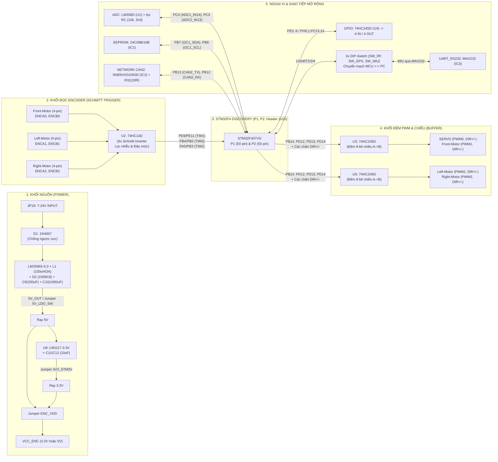
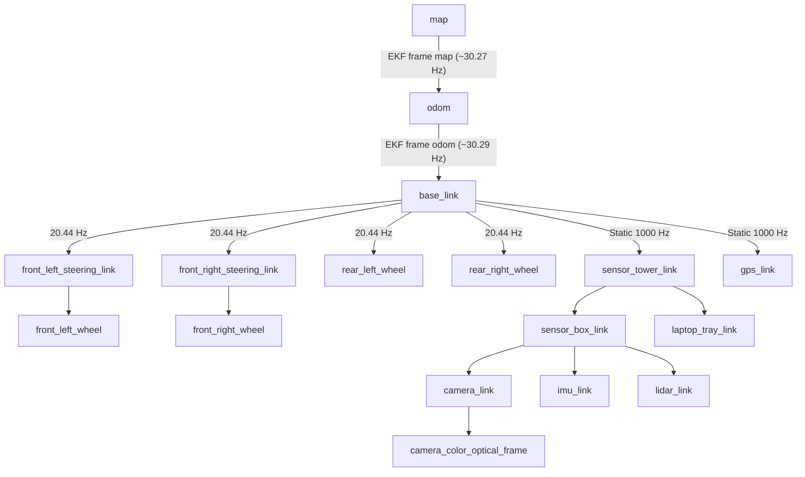
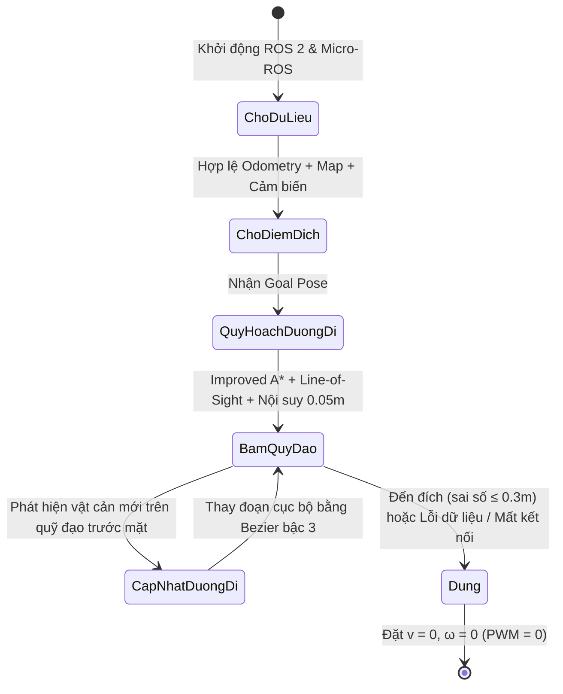
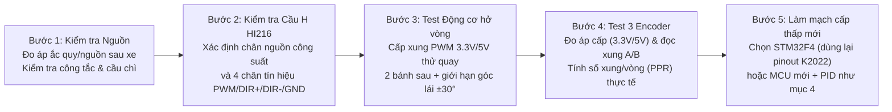

# Sơ Đồ Hóa Toàn Bộ Hệ Thống Đồ Án Khóa Trước (Thư Mục `K2022`) & Phân Tích Phần Cứng Kế Thừa

> [!NOTE]
> Tài liệu này tổng hợp chính xác dữ liệu từ toàn bộ thư mục [K2022](./K2022), chủ động bóc tách các điểm không đồng nhất giữa các phiên bản mạch Altium 2023–2025 và báo cáo [DATN.pdf](./K2022/DATN.pdf), đồng thời phân loại rõ phần cứng còn giữ trên xe để làm nền tảng cho đồ án mới.
>
> Xem thêm kiến trúc đề tài mới (không dây 3 lớp: STM32 + Raspberry Pi 4 + Laptop RTX 3050 + FGO SLAM `GTSAM iSAM2`) tại [FGO_OPTIMIZED_ARCHITECTURE.md](./FGO_OPTIMIZED_ARCHITECTURE.md).

---

## 1. Quản Lý Nhầm Lẫn & Phân Loại Tài Liệu Trong Thư Mục `K2022`

### Các giả định & dữ liệu đầu vào (Surface Assumptions)
1. **Xe được bàn giao** là khung xe Ackermann thực tế từ đồ án này, hiện **chỉ còn**: Khung cơ khí 4 bánh Ackermann, 3 Động cơ DC (2 bánh sau + 1 cơ cấu lái trước), 3 Encoder, 3 mạch cầu H công suất (`DRIVER - HI216`), và Khối Nguồn.
2. **Các thành phần đã bị tháo/mất**: Cụm STM32F4 Discovery + Custom PCB điều khiển cấp thấp, Máy tính trung tâm (PC ROS 2 Humble), Cụm cảm biến (LiDAR 3D, Camera, IMU) và dây tín hiệu nối lên tầng xử lý cấp cao.
3. Trong thư mục [K2022](./K2022) có **nhiều phiên bản thiết kế mạch lẫn báo cáo ở các mốc thời gian khác nhau**. Dưới đây là bảng đối chiếu để tránh đấu nối nhầm:

| Tài liệu / File | Thời điểm | Nội dung chính | Điểm khác biệt / Lưu ý quan trọng |
| :--- | :--- | :--- | :--- |
| [DATN.pdf](./K2022/DATN.pdf) | 05/2026 (116 trang) | Báo cáo ĐATN *"Thiết kế hệ thống robot di động tự hành từ mô phỏng đến thực tế"* (SV: Lê Gia Uy - 2213895, Nguyễn Vinh - 2213968; GVHD: TS. Nguyễn Vĩnh Hảo) | Mô tả toàn bộ hệ thống Sim-to-Real, 3 cầu H `HI216`, STM32F4 dùng ngắt `TIM8` 10ms, ROS 2 Humble, `FAST-LIO2`/`FAST-LIVO2`, Dual EKF, `Improved A*`, `A-GMPC`. **Hình 3.7** (trang 58) chụp một bản PCB khác (có nhãn `MORTOR`, `D12 D13 D14`, `A8 A9 A10`) so với bộ Altium `MainBoard_02_2023`. |
| [Sheet1.pdf](./K2022/Sheet1.pdf) & [MainBoard_02_2023_ver1.pdf](./K2022/MainBoard_02_2023_ver1.pdf) | 26/02/2023 | Schematic phiên bản cũ của `MainBoard_02_2023` | **Có lỗi thiết kế:** Gán trùng chân `PB5` cho cả `PWM_1 (TIM4_CH1)`, `PWM_2 (TIM4_CH2)`, `PWM_3 (TIM4_CH3)` và `PWM_0`; có khối `ISOBUS (CAN1)`; thiếu diode bảo vệ nguồn `D1`, `D2`. |
| [MainBoard_03_2023.pdf](./K2022/MainBoard_03_2023.pdf) & [Sheet1.SchDoc](./K2022/Sheet1.SchDoc) | Chỉnh sửa 2023–2024, xuất PDF 02/05/2025 | Schematic **bản hoàn thiện nhất** của Custom MainBoard | **Đã sửa lỗi PWM:** Tách đúng `PB14`, `PD12`, `PD13`, `PD14`. Đổi `ISOBUS` thành khối `UART_RS232 (MAX232)` cho IMU. Bổ sung `D1 (1N4007)` chống ngược cực đầu vào và `D2 (1N5819)` cho buck `LM2596S-5.0`. Đổi tên jumper thành `Front-Motor`, `Left-Motor`, `Right-Motor`, `SERVO`. |
| [Sheet2.SchDoc](./K2022/Sheet2.SchDoc) | 26/02/2023 | Schematic phụ (`TRIMBLE` / `MAX485` / `ISO_H`) | Bản vẽ nháp/rời về chuẩn giao tiếp `MAX485`/Trimble, không nằm trong `MainBoard_02_2023.PrjPcb` hiện hành. |
| [MainBoard_02_2023.xls](./K2022/Project%20Outputs%20for%20MainBoard_02_2023/MainBoard_02_2023.xls) & [Design Rule Check - PCB2.drc](./K2022/Project%20Outputs%20for%20MainBoard_02_2023/Design%20Rule%20Check%20-%20PCB2.drc) | 30/03/2023 – 14/04/2023 | BOM linh kiện và báo cáo kiểm tra lỗi mạch PCB2 | BOM liệt kê đầy đủ linh kiện của `MainBoard`. DRC ghi nhận 13 lỗi `Short-Circuit` do dùng jumper 0 Ohm / footprint và 4 lỗ bắt vít `TP1..TP4` lớn hơn 100 mil (không phải lỗi chạm mạch thực). |

---

## 2. Sơ Đồ 1: Tổng Quan Hệ Thống Gốc & Hiện Trạng Phần Cứng Còn Giữ

Sơ đồ dưới đây phân tách rõ **những gì đang có trên xe (màu xanh lá)** và **những gì khóa cũ đã làm nhưng hiện đã tháo/mất (màu đỏ nét đứt)**.

```mermaid
flowchart TB
    subgraph LOST_HIGH ["TẦNG XỬ LÝ CẤP CAO & CẢM BIẾN ( THÁO RỜI)"]
        direction TB
        MON["Monitoring PC<br/>(ROS 2 Humble)"]
        PC["Onboard Central PC<br/>(ROS 2 Humble:<br/>FAST-LIO2 / FAST-LIVO2, Dual EKF,<br/>ICP, Improved A* + Bezier, A-GMPC)"]
        LIDAR["LiDAR 3D<br/>(Ethernet)"]
        CAM["Camera RGB / Depth<br/>(USB)"]
        IMU["IMU chính<br/>(USB / RS232)"]

        LIDAR -->|"Ethernet"| PC
        CAM -->|"USB"| PC
        IMU -->|"USB"| PC
        PC <-->|"DDS Wireless"| MON
    end

    subgraph LOST_LOW ["TẦNG ĐIỀU KHIỂN CẤP THẤP ( THÁO RỜI)"]
        direction TB
        MCU["STM32F4 Discovery + Custom PCB<br/>(Micro-ROS Client + TIM8 10ms<br/>PID Vị trí lái + 2x PID Vận tốc)"]
    end

    subgraph KEPT_HW ["PHẦN CỨNG ĐƯỢC DÙNG LẠI TRÊN XE (CÒN NGUYÊN)"]
        direction LR
        PWR["Khối Nguồn<br/>(Ắc quy / Nguồn công suất<br/>khoang sau + cấp mạch)"]
        
        subgraph DRIVERS ["3 Mạch Cầu H Công Suất (HI216)"]
            DRV1["Driver 1: HI216<br/>(Cơ cấu lái trước)"]
            DRV2["Driver 2: HI216<br/>(Bánh sau Trái)"]
            DRV3["Driver 3: HI216<br/>(Bánh sau Phải)"]
        end

        subgraph ACTUATORS ["Cơ Cấu Chấp Hành & Phản Hồi trên Khung Ackermann"]
            M1["Động cơ Lái trước<br/>(Giới hạn góc lái ±30°)"]
            E1["Encoder 1<br/>(Đo góc lái δ)"]
            M2["Động cơ Bánh sau Trái<br/>(Wheel Base L = 0.65m)"]
            E2["Encoder 2<br/>(Đo vận tốc v_L)"]
            M3["Động cơ Bánh sau Phải<br/>(Kéo độc lập)"]
            E3["Encoder 3<br/>(Đo vận tốc v_R)"]
        end

        PWR ==>|"Nguồn công suất"| DRV1 & DRV2 & DRV3
        DRV1 ==> M1
        DRV2 ==> M2
        DRV3 ==> M3
        M1 -.- E1
        M2 -.- E2
        M3 -.- E3
    end

    PC -->|"USB-UART (Micro-ROS)<br/>Gửi: v_ref, ω_ref<br/>Nhận: odom"| MCU
    PC <--|"USB-UART (Micro-ROS)<br/>nhận: odom"| MCU

    MCU -->|"PWM_1 + DIR+/DIR-"| DRV1
    MCU -->|"PWM_2 + DIR+/DIR-"| DRV2
    MCU -->|"PWM_3 + DIR+/DIR-"| DRV3
    E1 -->|"Kênh A/B"| MCU
    E2 -->|"Kênh A/B"| MCU
    E3 -->|"Kênh A/B"| MCU

    classDef kept fill:#d1fae5,stroke:#059669,stroke-width:2px,color:#064e3b;
    classDef lost fill:#fee2e2,stroke:#dc2626,stroke-width:2px,stroke-dasharray: 5 5,color:#7f1d1d;
    class PWR,DRV1,DRV2,DRV3,M1,M2,M3,E1,E2,E3 kept;
    class MON,PC,LIDAR,CAM,IMU,MCU lost;
```

### Giao tiếp của phần cứng còn lại trên xe
Để điều khiển lại chiếc xe hiện tại (không cần dùng lại đúng bo mạch cũ), cần nắm giao tiếp vào/ra của **Cầu H `HI216`** và **3 Encoder**:
1. **Giao tiếp điều khiển Cầu H (`DRIVER - HI216`)**: Mỗi mạch cầu H nhận **4 dây tín hiệu** từ vi điều khiển (theo chuẩn connector trên `MainBoard_03_2023` và `DATN.pdf` Hình 3.6):
   - `PWMx`: Xung PWM điều chỉnh độ rộng xung (tốc độ / điện áp trung bình). Trong firmware cũ, dải duty giới hạn trong $[-4200, 4200]$.
   - `PWMx_DIR+` và `PWMx_DIR-`: 2 chân điều khiển chiều quay thuận/nghịch (hoặc kích chân Enable/Direction của cầu H `HI216`).
   - `GND`: Mass tham chiếu chung với vi điều khiển.
2. **Giao tiếp 3 Encoder (4 chân/cổng)**:
   - Chân 1: `GND`
   - Chân 2: `ENC_Bx` (Pha B)
   - Chân 3: `ENC_Ax` (Pha A)
   - Chân 4: `VCC_ENC` (Nguồn nuôi encoder — trên mạch cũ có jumper chọn `3.3V` hoặc `5V`)
3. **Thông số cơ khí nền tảng Ackermann** (báo cáo `DATN.pdf` Bảng 4.9, 4.10 & Mục 4.4.4):
   - Chiều dài cơ sở (`wheel_base`): $L = 0.65\text{ m}$
   - Giới hạn góc lái (`max_steer_deg`): $-30^\circ \le \delta \le +30^\circ$
   - Truyền động: 2 bánh sau kéo độc lập (2 động cơ + 2 encoder), 1 cụm lái phía trước (1 động cơ + 1 encoder vị trí).

---

## 3. Sơ Đồ 2: Kiến Trúc Điện & Pinout Custom PCB (`MainBoard_03_2023`)

Nếu chế tạo lại mạch điều khiển hoặc đấu dây tương thích với code cũ trên STM32F407 Discovery, toàn bộ sơ đồ phần cứng trên [MainBoard_03_2023.pdf](./K2022/MainBoard_03_2023.pdf) được tổ chức như sau:



### Bảng tra cứu Pinout đầy đủ trên `MainBoard_03_2023` (STM32F4 Discovery)

| Nhóm chức năng | Tên tín hiệu (Schematic) | Chân STM32F4 | Ngoại vi / Timer | IC đệm trung gian | Đầu nối ra (Connector) | Vai trò trên xe |
| :--- | :--- | :--- | :--- | :--- | :--- | :--- |
| **Encoder 0 (Lái)** | `ENC_A0` / `ENC_B0` | `PE9` / `PE11` | `TIM1_CH1` / `TIM1_CH2` | `U2 (74HC14D)` | `Front-Motor` (4 pin) | Đo góc lái cơ cấu trước |
| **Encoder 1 (Trái)** | `ENC_A1` / `ENC_B1` | `PB4` / `PB5` | `TIM3_CH1` / `TIM3_CH2` | `U2 (74HC14D)` | `Left-Motor` (4 pin) | Đo vận tốc bánh sau trái |
| **Encoder 2 (Phải)** | `ENC_A2` / `ENC_B2` | `PA5` / `PB3` | `TIM2_CH1` / `TIM2_CH2` | `U2 (74HC14D)` | `Right-Motor` (4 pin) | Đo vận tốc bánh sau phải |
| **PWM 0 (Dự phòng)** | `PWM_0` / `DIR-` / `DIR+` | `PB14` / `PD10` / `PB15` | `TIM12_CH1` + GPIO | `U3 (74HC245D)` | `SERVO` (4 pin) | Kênh dự phòng |
| **PWM 1 (Lái trước)** | `PWM_1` / `DIR-` / `DIR+` | `PD12` / `PD11` / `PC7` | `TIM4_CH1` + GPIO | `U3 (74HC245D)` | `Front-Motor` (4 pin) | Lái cầu H `HI216` cơ cấu lái |
| **PWM 2 (Bánh trái)** | `PWM_2` / `DIR-` / `DIR+` | `PD13` / `PA6` / `PA4` | `TIM4_CH2` + GPIO | `U5 (74HC245D)` | `Left-Motor` (4 pin) | Lái cầu H `HI216` bánh sau trái |
| **PWM 3 (Bánh phải)** | `PWM_3` / `DIR-` / `DIR+` | `PD14` / `PC1` / `PC0` | `TIM4_CH3` + GPIO | `U5 (74HC245D)` | `Right-Motor` (4 pin) | Lái cầu H `HI216` bánh sau phải |
| **UART GPS / RTK** | `GPS_TX_MCU` / `GPS_RX_MCU` | `PA2` / `PA3` | `USART2_TX` / `RX` | `SW_GPS` (DIP-4) | `GPS`, `RF_RTK`, `GPS_PC` | Giao tiếp GPS/RTK hoặc PC |
| **UART IMU (RS232)** | `IMU_TX_MCU` / `IMU_RX_MCU` | `PD8` / `PD9` | `USART3_TX` / `RX` | `IC3 (MAX232)` + `SW_IMU` | `IMU`, `IMU_PC` | Giao tiếp IMU chuẩn RS232 |
| **UART RF** | `RF_TX_MCU` / `RF_RX_MCU` | `PC10` / `PC11` | `USART4_TX` / `RX` | `SW_RF` (DIP-4) | `RF`, `RF_PC` | Giao tiếp RF không dây |
| **CAN Bus 1 & 2** | `ISO_TX/RX`, `NET_TX/RX` | `PD1/PD0`, `PB13/PB12` | `CAN1` / `CAN2` | `IC2 (SN65HVD1050D)` | `CAN1_A`, `CAN1_B` | Mạng CAN + trở đầu cuối `120R` |
| **EEPROM** | `EEP_SDA` / `EEP_SCL` | `PB7` / `PB8` | `I2C1_SDA` / `SCL` | Trở kéo `4k7` | `IC1 (24C08B/16B)` | Lưu cấu hình hệ thống |
| **ADC** | `ADC_0` / `ADC_1` | `PC4` / `PC3` | `ADC1_IN14` / `ADC2_IN13` | `U1 (LM358D)` + RC | `JP4` (4 pin) | Đọc cảm biến analog / áp pin |
| **GPIO Đệm** | `IN_0..3` / `OUT_0..3` | `PE6..PE3` / `PH0,PH1,PC13,PC14` | Digital I/O | `U4 (74HC245D)` | `GPIO_IN`, `GPIO_OUT` | Ngõ vào/ra số cách ly đệm |

> [!WARNING]
> **Lưu ý khi đọc Hình 3.7 trong `DATN.pdf` (trang 58):** Ảnh PCB mặt trước/sau trong báo cáo ghi các ký hiệu chân trên header như `D12 D13 D14` (khớp `PD12, PD13, PD14` cho `PWM_1,2,3`), `A6 A7` / `A8 A9 A10`, và dùng `RX3 TX3` / `RX2 TX2`. Đồng thời firmware trong báo cáo dùng ngắt `Timer 8 (TIM8)` chu kỳ `10 ms` (100 Hz). Khi tự làm lại mạch cấp thấp mới, nên coi bảng chân từ `MainBoard_03_2023.pdf` làm tham chiếu nguyên lý chính xác và chọn chân PWM/Encoder phù hợp với vi điều khiển sử dụng.

---

## 4. Sơ Đồ 3: Kiến Trúc Firmware & Điều Khiển Cấp Thấp Trên STM32F4

Firmware trên STM32F4 (báo cáo `DATN.pdf` Mục 3.3.4, 3.4.3 & 4.4.4) chạy song song 2 tác vụ chính: vòng lặp giao tiếp **Micro-ROS** với máy tính trung tâm và ngắt cứng **Timer 8 (`TIM8`)** ở tần số $100\text{ Hz}$ ($T_s = 10\text{ ms}$) để thực thi PID.

```mermaid
flowchart TB
    subgraph MAIN_LOOP ["LUỒNG CHÍNH: GIAO TIẾP MICRO-ROS (Vòng lặp 10 ms)"]
        M_START(["Bắt đầu STM32F4"]) --> INIT1["Khởi tạo Micro-ROS & Cấu trúc tin nhắn"]
        INIT1 --> INIT2["Khởi tạo Node, Publisher/Subscriber & Executor"]
        INIT2 --> INIT3["Khởi tạo Motor, PID & Bật ngắt Timer 8 (10ms)"]
        INIT3 --> CHK{"Kiểm tra kết nối<br/>Micro-ROS Agent?"}
        CHK -->|"Chưa kết nối"| CHK
        CHK -->|"Đã kết nối"| READ_M["Đọc dữ liệu Motor & Encoder an toàn"]
        READ_M --> PUB["Gán dữ liệu & Publish lên ROS 2<br/>(/joint_states, feedback)"]
        PUB --> PING["Ping Agent & Xử lý Callbacks<br/>(Nhận lệnh v_ref, ω_ref)"]
        PING --> DLY["Delay 10 ms"]
        DLY --> CHK
    end

    subgraph TIM8_ISR ["LUỒNG THỜI GIAN THỰC: NGẮT TIMER 8 (Ts = 10 ms / 100 Hz)"]
        T_START(["Ngắt TIM8"]) --> READ_ENC["Đọc xung 3 Encoder:<br/>Góc lái δ, Bánh trái N_L, Bánh phải N_R"]
        READ_ENC --> CALC_V["Tính rev(k) = ΔN(k) / PPR<br/>v_raw = (rev(k) / Ts) * 2πR<br/>Lọc EMA: v(k) = 0.25*v_raw + 0.75*v(k-1)"]
        CALC_V --> FAILSAFE{"Kết nối Micro-ROS<br/>hợp lệ?"}
        
        FAILSAFE -->|"Mất kết nối (An toàn)"| ZERO["Đặt PWM = 0"]
        ZERO --> RST_PID["Reset bộ tích phân PID"]
        RST_PID --> SYNC["Reset target_speed = 0, target_angle<br/>& đồng bộ encoder"]
        SYNC --> T_END(["Thoát ngắt TIM8"])

        FAILSAFE -->|"Có kết nối"| KIN["Tính góc lái đặt (nếu |v| > 0.01):<br/>δ_ref = arctan(ω * L / v)<br/>Giới hạn: -30° ≤ δ_ref ≤ +30°"]
        KIN --> PID_STEER["PID Vị trí Cơ cấu lái:<br/>e_δ(k) = δ_ref(k) - δ(k)<br/>Kp=6000, Ki=2500, Kd=400"]
        PID_STEER --> PID_WHEEL["2x PID Vận tốc Bánh sau (Trái & Phải):<br/>e_v,i(k) = v_ref(k) - v_i(k)<br/>Kp=7000, Ki=6000, Kd=0"]
        PID_WHEEL --> SAT["Giới hạn xung cầu H:<br/>-4200 ≤ duty(k) ≤ +4200<br/>Xuất PWM + DIR+/DIR- ra 3 Driver HI216"]
        SAT --> T_END
    end
```



### Công thức PID rời rạc song song & Kết quả thực nghiệm cấp thấp
- **Dạng PID triển khai trên STM32F4** (Phương trình 116–119, trang 91):
  - $P(k) = K_p e(k)$
  - $I(k) = I(k-1) + \frac{1}{2} K_i T_s [e(k) + e(k-1)]$
  - $D(k) = \frac{2 K_d}{T_s} (e_f(k) - e_f(k-1)) - D(k-1)$ (với $e_f$ đã qua lọc thông thấp)
  - $u(k) = P(k) + I(k) + D(k)$, bão hòa trong $[-4200, 4200]$ trước khi xuất ra phần cứng PWM.
- **Chất lượng đáp ứng đo trên xe thật** (Bảng 5.3, trang 102):

| Vòng điều khiển | Bộ thông số PID | Thời gian xác lập | Vọt lố cực đại | Sai số xác lập |
| :--- | :--- | :---: | :---: | :---: |
| **PID Vận tốc 2 bánh sau** | $K_p = 7000,\ K_i = 6000,\ K_d = 0$ | $1.05\text{ s}$ | $3.8\%$ | $0.087\text{ m/s}$ |
| **PID Vị trí cơ cấu lái** | $K_p = 6000,\ K_i = 2500,\ K_d = 400$ | $0.98\text{ s}$ | $1.4\%$ | $1.18^\circ$ |

---

## 5. Sơ Đồ 4: Kiến Trúc Tự Hành Cấp Cao Trên ROS 2 Humble (Sim-to-Real)

Khóa trước xây dựng toàn bộ phần mềm tự hành theo quy trình **Sim-to-Real (Gazebo $\rightarrow$ Robot thật)** giữ nguyên tên Topic, kiểu dữ liệu và cây TF giữa mô phỏng và thực tế.

### 5.1. Sơ đồ luồng dữ liệu & Thuật toán ROS 2

```mermaid
flowchart LR
    subgraph SENSORS ["NGUỒN DỮ LIỆU ĐẦU VÀO"]
        S_LIDAR["LiDAR 3D<br/>(/scan, PointCloud2)"]
        S_CAM["Camera RGB-D<br/>(/camera/...)"]
        S_IMU1["IMU chính<br/>(/imu/data)"]
        S_IMU2["IMU từ Camera"]
        S_WH["Wheel Odometry<br/>(Encoder bánh sau)"]
    end

    subgraph SLAM_LOC ["TẦNG ĐỊNH VỊ & LẬP BẢN ĐỒ"]
        FLIO["FAST-LIO2 / FAST-LIVO2<br/>(LiDAR + IMU + Camera)"]
        PCD2PGM["pcd2pgm<br/>Lọc Z∈[0.5, 2.0]m, res=0.05m<br/>r=0.1m, min_pts=10"]
        MAP2D["Bản đồ chiếm dụng 2D<br/>(/map - OccupancyGrid)"]
        ICP["ICP Scan-to-Map<br/>(max_iter=80, max_corr=1.5m<br/>fitness_thres=35.0)"]
        EKF_ODOM["EKF Frame odom (2D, 30Hz)<br/>Hợp nhất: Wheel + IMU1 + IMU2 + FAST-LIO/LIVO"]
        EKF_MAP["EKF Frame map (2D)<br/>Hợp nhất: Wheel + IMU1 + Pose ICP"]
    end

    subgraph PLAN_CTRL ["TẦNG QUY HOẠCH & ĐIỀU KHIỂN BÁM QUỸ ĐẠO"]
        ASTAR["Improved A* (8 hướng)<br/>Mở rộng vật cản n_ex = ceil(D_s/p)<br/>Cost≤50, Phạt rẽ C=0.2"]
        POST["Hậu xử lý quỹ đạo<br/>Cắt tỉa Line-of-Sight<br/>Nội suy bước 0.05m (/path)"]
        BEZIER["Tránh vật cản cục bộ<br/>Thay đoạn trước mặt bằng<br/>Đường cong Bezier bậc 3"]
        AGMPC["Ackermann Geometric MPC<br/>(hoặc Standard MPC)<br/>30Hz, Np=30, dt=0.1s, OSQP"]
    end

    subgraph LOW_LVL ["TẦNG CHẤP HÀNH"]
        UROS["Micro-ROS Agent (USB-UART)<br/>Topic /cmd_vel -> STM32F4"]
    end

    S_LIDAR & S_IMU1 & S_CAM --> FLIO
    FLIO -->|"Point Cloud 3D"| PCD2PGM --> MAP2D
    FLIO -->|"LiDAR/Visual Odom"| EKF_ODOM
    S_WH & S_IMU1 & S_IMU2 --> EKF_ODOM
    
    S_LIDAR & MAP2D --> ICP
    S_WH & S_IMU1 & ICP --> EKF_MAP
    
    EKF_MAP -->|"Pose robot (frame map)"| ASTAR
    MAP2D --> ASTAR
    ASTAR --> POST --> BEZIER
    S_LIDAR -.->|"Phát hiện vật cản mới"| BEZIER
    
    BEZIER -->|"Quỹ đạo tham chiếu"| AGMPC
    EKF_ODOM -->|"Odometry liên tục<br/>(/odometry/filtered)"| AGMPC
    AGMPC -->|"u_cmd = [v_ref, ω_ref]"| UROS
```



### 5.2. Cây Biến Đổi Tọa Độ TF (`tf2` Tree)
Theo `Hình 3.9` (trang 64) và `Mục 3.4.2` của `DATN.pdf`, cây tọa độ chuẩn của xe gồm:



### 5.3. Bảng tổng hợp ROS 2 Topics chính (Bảng 3.4, trang 63)

| Tên Topic | Kiểu dữ liệu (`msg`) | Vai trò trong hệ thống |
| :--- | :--- | :--- |
| `/scan` hoặc topic PointCloud | `sensor_msgs/LaserScan` hoặc `PointCloud2` | Dữ liệu quét môi trường từ LiDAR |
| `/imu/data` | `sensor_msgs/Imu` | Gia tốc, vận tốc góc quán tính |
| `/camera/...` | `Image` / Depth | Dữ liệu hình ảnh/độ sâu phục vụ `FAST-LIVO2` |
| `/odom` hoặc `/odometry/filtered` | `nav_msgs/Odometry` | Trạng thái ước lượng từ EKF |
| `/map` | `nav_msgs/OccupancyGrid` | Bản đồ lưới chiếm dụng 2D |
| `/path` hoặc `/plan` | `nav_msgs/Path` | Quỹ đạo tham chiếu từ `Improved A*` |
| `/cmd_vel` | `geometry_msgs/Twist` / `TwistStamped` | Lệnh vận tốc $(v, \omega)$ gửi xuống STM32F4 |
| `/joint_states` | `sensor_msgs/JointState` | Phản hồi trạng thái bánh xe và góc lái từ STM32F4 |

### 5.4. Chi tiết 2 Bộ Điều Khiển Bám Quỹ Đạo (Standard MPC vs. A-GMPC)
Khóa trước đã triển khai và so sánh 2 bộ điều khiển cùng chạy ở tần số **30 Hz** (chu kỳ $33.3\text{ ms}$), miền dự báo $N_p = 30$, bước rời rạc $dt = 0.1\text{ s}$, giải bằng bộ giải tối ưu lồi **OSQP**, `wheel_base` $L = 0.65\text{ m}$, giới hạn góc lái $\pm 30^\circ$:

1. **Standard MPC (Cơ sở đối chứng):**
   - Vector sai số 2 chiều: $\mathbf{e}_k = [e_y(k),\ e_\psi(k)]^T$.
   - Biến tối ưu: góc lái $\delta_0 \dots \delta_{N_p-1}$, chuyển sang $\omega = \frac{v_{\text{ref}}}{L}\tan(\delta_0^*)$.
   - Trọng số: $Q_{ey} = 35.0$, $Q_{e\psi} = 25.0$, $R_\delta = 17.0$.
2. **Ackermann Geometric MPC (`A-GMPC` — Bộ điều khiển chính đề xuất):**
   - Biểu diễn tư thế trên nhóm Lie $SE(2)$: sai số hình học $E_k = T_{\text{ref},k}^{-1} T_k \in SE(2)$, ánh xạ Log về đại số Lie $\xi_k = \text{Log}(E_k) = [e_x(k),\ e_y(k),\ e_\psi(k)]^T$.
   - Biến tối ưu là **gia lượng điều khiển** $\Delta \mathbf{u}_k = [\Delta v_k,\ \Delta \omega_k]^T$ (giúp làm mượt lệnh lái và vận tốc trên cơ cấu Ackermann có giới hạn cơ khí).
   - Trọng số: $Q = \text{diag}(10.0,\ 40.0,\ 25.0)$, $R = \text{diag}(30.0,\ 0.5)$, $R_\Delta = \text{diag}(20.0,\ 25.0)$.
   - **Hiệu năng thực tế:**
     - Thời gian xử lý trung bình: **$1.41\text{ ms}$** (OSQP mất $0.41\text{ ms}$), rất nhỏ so với hạn mức $33.3\text{ ms}$.
     - Thử nghiệm tự hành hoàn chỉnh ngoài trời (quãng đường $114.03\text{ m}$, vận tốc trung bình $0.95\text{ m/s}$): đạt sai số bám đường **$\text{RMSE} = 0.2627\text{ m}$**.
     - Ở vận tốc cao $1.5\text{ m/s}$ trên quỹ đạo Square, `A-GMPC` đạt RMSE $0.6182\text{ m}$ (giảm gần một nửa so với $1.1475\text{ m}$ của Standard MPC).

---

## 6. Trạng Thái Vận Hành Toàn Hệ Thống (State Machine)



---

## 7. Đánh Giá Khả Năng Tái Sử Dụng & Lộ Trình Cho Đồ Án Mới

Với việc hiện tại **chỉ còn Khung xe Ackermann, Nguồn, 3 Cầu H `HI216`, 3 Động cơ và 3 Encoder**, toàn bộ phần "cơ bắp & truyền động" đắt tiền và khó gia công nhất của chiếc xe vẫn còn nguyên.



### Những việc cần lưu ý ngay khi tiếp nhận phần cứng:
1. **Xác định lại mức logic & dây của `DRIVER - HI216`:** Kiểm tra thực tế trên xe xem 3 mạch cầu H `HI216` cần logic điều khiển `3.3V` hay `5V` (trong mạch cũ có `74HC245D` cấp nguồn `3V3` làm buffer đẩy dòng chứ không nâng áp lên `5V`).
2. **Đo lại tham số `PPR` của 3 Encoder và hành trình cơ cấu lái:** Vì file firmware C của STM32F4 không nằm trong thư mục `K2022`, cần tự đo số xung trên một vòng quay (`PPR`) của encoder bánh sau và số xung tương ứng góc $\pm 30^\circ$ của trục lái trước khi nạp bộ thông số PID tham khảo ($K_p, K_i, K_d$).
3. **Bổ sung mạch bảo vệ & công tắc hành trình (Limit Switch) khi test lái:** Tuyệt đối chưa chạy vòng kín PID vị trí góc lái khi chưa kiểm tra chiều quay của động cơ lái so với chiều tăng/giảm của encoder lái (nếu ngược dấu hồi tiếp âm sẽ biến thành hồi tiếp dương làm kẹt/gãy cơ cấu lái).
