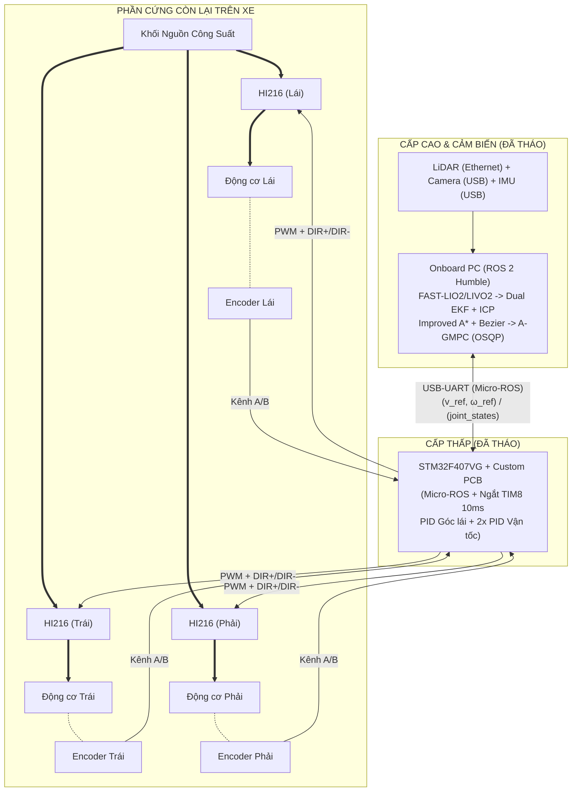

# Kiến Trúc Hệ Thống Đồ Án Khóa Trước (`K2022`) — Tài Liệu Tham Chiếu Workspace

Tài liệu này được trích xuất trực tiếp từ thư mục [K2022](./K2022) nhằm làm ngữ cảnh nền tảng cho quá trình tái sử dụng phần cứng xe Ackermann hiện có.

## 1. Danh Mục Tài Liệu Nguồn & Sai Khác Giữa Các Phiên Bản

- **[K2022/DATN.pdf](./K2022/DATN.pdf)** (116 trang, bảo vệ 05/2026 — SV: Lê Gia Uy `2213895`, Nguyễn Vinh `2213968`, GVHD: TS. Nguyễn Vĩnh Hảo): Mô tả toàn bộ hệ thống robot Ackermann tự hành Sim-to-Real (Gazebo + ROS 2 Humble + Micro-ROS + STM32F4 + 3x Driver `HI216`).
- **[K2022/MainBoard_03_2023.pdf](./K2022/MainBoard_03_2023.pdf)** & **[K2022/Sheet1.SchDoc](./K2022/Sheet1.SchDoc)** (xuất 02/05/2025): Bản vẽ nguyên lý **hoàn thiện nhất** của Custom MainBoard. Đã sửa lỗi trùng chân `PB5` ở bản cũ ([Sheet1.pdf](./K2022/Sheet1.pdf) / [MainBoard_02_2023_ver1.pdf](./K2022/MainBoard_02_2023_ver1.pdf) ngày 26/02/2023), thêm diode bảo vệ nguồn `D1 (1N4007)` và `D2 (1N5819)`, và chuyển khối `ISOBUS CAN1` thành `UART_RS232 (MAX232)` cho IMU.
- **Lưu ý đối chiếu PCB:** Ảnh PCB ở `Hình 3.7` trong `DATN.pdf` (trang 58, có nhãn `MORTOR`, `D12 D13 D14`, `A6 A7`) thuộc một biến thể board khác so với layout `PCB2.PcbDoc` trong project `MainBoard_02_2023.PrjPcb`.

## 2. Hiện Trạng Phần Cứng Bàn Giao vs. Hệ Thống Gốc

### Phần cứng CÒN LẠI trên xe của bạn
- **Khung xe Ackermann 4 bánh**: Chiều dài cơ sở `wheel_base` $L = 0.65\text{ m}$, giới hạn góc lái $-30^\circ \le \delta \le +30^\circ$.
- **3 Cụm Động cơ DC & 3 Encoder**:
  - 1 động cơ cơ cấu lái phía trước + 1 encoder phản hồi góc lái.
  - 2 động cơ truyền động bánh sau (Trái, Phải) + 2 encoder đo vận tốc độc lập.
- **3 Mạch cầu H (`DRIVER - HI216`)**: Nhận xung PWM và tín hiệu điều hướng (`PWM`, `DIR+`, `DIR-`, `GND`) từ tầng điều khiển cấp thấp.
- **Khối Nguồn**: Hệ thống nguồn công suất đặt ở khoang sau xe.

### Phần cứng ĐÃ MẤT / THIẾU (cần làm lại hoặc thay thế)
- **Tầng điều khiển cấp thấp**: Board `STM32F407VG Discovery` + Custom Baseboard (`MainBoard_03_2023`) + Firmware C/Micro-ROS.
- **Tầng xử lý cấp cao**: Máy tính trung tâm chạy `ROS 2 Humble`.
- **Cụm cảm biến ngoại vi**: LiDAR 3D (Ethernet), Camera RGB-D (USB), IMU (USB / RS232).

## 3. Sơ Đồ Kiến Trúc Tổng Thể (Hệ Thống Gốc K2022)

## 4. Pinout Tham Chiếu Của `MainBoard_03_2023` (STM32F4 Discovery)

### Khối Nguồn & Mức Logic
- **Nguồn vào `JP19`**: `7-24V` $\rightarrow$ Diode `D1 (1N4007)` $\rightarrow$ Buck `LM2596S-5.0` (`L1 = 100uH/3A`, `D2 = 1N5819`) $\rightarrow$ `5V_OUT` $\rightarrow$ LDO `LM1117-3.3V` $\rightarrow$ `3V3`.
- **Nguồn Encoder (`VCC_ENC`)**: Chọn `3V3` hoặc `5V` qua jumper `ENC_VDD`.
- **Đệm tín hiệu**:
  - Encoder đầu vào đi qua `U2 (74HC14D)` (Schmitt Trigger Inverter) trước khi vào chân Timer.
  - Ngõ ra PWM & `DIR+/-` đi qua `U3`, `U5 (74HC245D)` (đệm 3.3V).

### Bảng Chân STM32F407VG (`P1`, `P2` Header 2x25)

| Nhóm | Tín hiệu | Chân MCU | Peripheral | Đầu nối |
| :--- | :--- | :--- | :--- | :--- |
| **Encoder Lái** | `ENC_A0` / `ENC_B0` | `PE9` / `PE11` | `TIM1_CH1` / `TIM1_CH2` | `Front-Motor` |
| **Encoder Trái** | `ENC_A1` / `ENC_B1` | `PB4` / `PB5` | `TIM3_CH1` / `TIM3_CH2` | `Left-Motor` |
| **Encoder Phải** | `ENC_A2` / `ENC_B2` | `PA5` / `PB3` | `TIM2_CH1` / `TIM2_CH2` | `Right-Motor` |
| **PWM Dự phòng** | `PWM_0` / `DIR-` / `DIR+` | `PB14` / `PD10` / `PB15` | `TIM12_CH1` + GPIO | `SERVO` |
| **PWM Lái** | `PWM_1` / `DIR-` / `DIR+` | `PD12` / `PD11` / `PC7` | `TIM4_CH1` + GPIO | `Front-Motor` |
| **PWM Trái** | `PWM_2` / `DIR-` / `DIR+` | `PD13` / `PA6` / `PA4` | `TIM4_CH2` + GPIO | `Left-Motor` |
| **PWM Phải** | `PWM_3` / `DIR-` / `DIR+` | `PD14` / `PC1` / `PC0` | `TIM4_CH3` + GPIO | `Right-Motor` |
| **UART GPS/RTK** | `GPS_TX/RX_MCU` | `PA2` / `PA3` | `USART2` (qua `SW_GPS`) | `GPS` / `RF_RTK` |
| **UART IMU** | `IMU_TX/RX_MCU` | `PD8` / `PD9` | `USART3` (`MAX232` + `SW_IMU`) | `IMU` / `IMU_PC` |
| **UART RF** | `RF_TX/RX_MCU` | `PC10` / `PC11` | `USART4` (qua `SW_RF`) | `RF` / `RF_PC` |
| **CAN2 / CAN1** | `NET_TX/RX` / `ISO_TX/RX` | `PB13/PB12` / `PD1/PD0` | `CAN2 (SN65HVD1050D)` / `CAN1` | `CAN1_A`, `CAN1_B` |
| **I2C EEPROM** | `EEP_SDA` / `EEP_SCL` | `PB7` / `PB8` | `I2C1` (Pull-up `4k7`) | `IC1 (24C08B/16B)` |
| **ADC** | `ADC_0` / `ADC_1` | `PC4` / `PC3` | `ADC1_IN14` / `ADC2_IN13` (`LM358D`) | `JP4` |
| **GPIO Đệm** | `IN_0..3` / `OUT_0..3` | `PE6..3` / `PH0,1,PC13,14` | Digital I/O (`U4: 74HC245D`) | `GPIO_IN`, `GPIO_OUT` |

## 5. Thông Số Thuật Toán & Điều Khiển Cấp Thấp / Cấp Cao

### Điều khiển cấp thấp (`STM32F4` - Ngắt `TIM8`, $T_s = 10\text{ ms}$)
- **Failsafe**: Mất kết nối Micro-ROS $\rightarrow$ `PWM = 0`, reset bộ tích phân PID, đồng bộ encoder.
- **Lọc vận tốc**: $v_{\text{raw}}(k) = \frac{\Delta N(k)}{PPR \cdot T_s}\cdot 2\pi R$; EMA: $v(k) = 0.25 v_{\text{raw}}(k) + 0.75 v(k-1)$.
- **Chuyển đổi động học Ackermann**: $\delta_{\text{ref}} = \arctan\left(\frac{\omega L}{v}\right)$ (khi $|v| > 0.01$, giới hạn $\pm 30^\circ$).
- **PID Vị trí Lái**: $K_p = 6000,\ K_i = 2500,\ K_d = 400$ (xác lập $0.98\text{ s}$, vọt lố $1.4\%$, sai số $1.18^\circ$).
- **PID Vận tốc Bánh sau**: $K_p = 7000,\ K_i = 6000,\ K_d = 0$ (xác lập $1.05\text{ s}$, vọt lố $3.8\%$, sai số $0.087\text{ m/s}$).
- **Giới hạn PWM xuất**: $-4200 \le \text{duty}(k) \le 4200$.

### Điều hướng tự hành cấp cao (`ROS 2 Humble`)
- **Định vị & Map**:
  - `EKF frame odom` (2D, $30\text{ Hz}$): Wheel Odom + IMU chính + IMU camera + `FAST-LIO2`/`FAST-LIVO2`.
  - `pcd2pgm`: $0.05\text{ m}$ resolution, $z \in [0.5, 2.0]\text{ m}$, radius $0.1\text{ m}$, min points $10$.
  - `ICP scan-to-map` (max 80 iter, max corr $1.5\text{ m}$, fitness $35.0$) + `EKF frame map` (2D).
- **Quy hoạch đường đi**: `Improved A*` (8 hướng, $\text{Cost} \le 50$, phạt đổi hướng $0.2$, loại điểm dư Line-of-Sight, nội suy $0.05\text{ m}$) + cập nhật cục bộ bằng **Bezier bậc 3**.
- **Bám quỹ đạo (`A-GMPC`)**: Nhóm Lie $SE(2)$, $N_p = 30$, $dt = 0.1\text{ s}$, $v_{\text{ref}} = 1.1\text{ m/s}$, giải bằng `OSQP` ($1.41\text{ ms}$/chu kỳ), trọng số $Q = \text{diag}(10, 40, 25)$, $R = \text{diag}(30, 0.5)$, $R_\Delta = \text{diag}(20, 25)$. Thực nghiệm đạt $\text{RMSE} = 0.2627\text{ m}$ trên quãng đường $114.03\text{ m}$.

---

## 6. Kiến Trúc Đề Tài Mới: Hệ Thống Xe Tự Hành Ackermann 10 km/h Không Dây Dùng Raspberry Pi & FGO SLAM (`GTSAM iSAM2`)

Phần này ghi nhận kiến trúc **3 lớp không dây đã tối ưu hóa** theo yêu cầu thực tế (Raspberry Pi đặt trên xe chạy không dây với Laptop RTX 3050 đặt ở trạm mặt đất), trên nền khung xe Ackermann `K2022`.

### 6.1. Thay đổi cốt lõi để chạy không dây ổn định ở $10\text{ km/h}$ ($2.78\text{ m/s}$)
1. **Kiến trúc 3 lớp tối ưu (Giữ Raspberry Pi trên xe, BỎ ESP32 trung gian):**
   - **Trên xe (`STM32F4` $\xleftrightarrow{\text{USB-UART 921600}}$ `Raspberry Pi 4/5`):** Nối dây trực tiếp từ STM32 vào Pi trên xe (không truyền Wi-Fi qua ESP32 để tránh jitter $5-80\text{ ms}$). Nguồn nuôi Pi phải dùng mạch Buck `5V/5A` riêng biệt trực tiếp từ ắc quy.
   - **Tại chỗ trên Raspberry Pi (Edge Sync & Deskewing):** Vì cả `YDLIDAR S2` và `STM32 (3 Encoder + IMU)` đều cắm dây vào Pi (chung đồng hồ `CLOCK_MONOTONIC`), **Pi thực hiện luôn `laser_filters`, `Dynamic Yaw Blending`, và `Motion Deskewing`** trước khi gửi `PointCloud2` đã nắn méo qua Wi-Fi 5GHz.
   - **Tại trạm mặt đất (`Laptop RTX 3050` $\xleftrightarrow{\text{Wi-Fi 5GHz / CycloneDDS}}$ `Pi trên xe`):** Chạy `YOLOv8 TensorRT` (từ ảnh nén `/camera/image_raw/compressed`), `Multi-Res CSM`, `GTSAM iSAM2` (FGO), bản đồ lưới và `Frontier Exploration` + bộ điều khiển bám quỹ đạo Ackermann.
   - **An toàn Dual Watchdog ($200\text{ ms}$):** Mất kết nối Wi-Fi từ Laptop $> 200\text{ ms}$, Pi lập tức ra lệnh dừng (`v_ref = 0`); mất UART $> 200\text{ ms}$, STM32 cắt `PWM = 0` và reset PID.
2. **Hiệu chỉnh mô hình động học từ Vi sai 4 Encoder sang Ackermann 3 Encoder:**
   - $v_{\text{odom},x} = \frac{v_L + v_R}{2}$, $\omega_{\text{steer}} = \frac{v_{\text{odom},x}}{0.65}\tan(\delta)$, $\omega_{\text{diff}} = \frac{v_R - v_L}{W}$.
   - Dùng sai lệch $|\omega_{\text{steer}} - \omega_{\text{imu},z}|$ và $|a_{\text{odom},x} - a_{\text{lin\_imu},x}|$ để phát hiện riêng trượt bánh trước (*Understeer*) và trượt quay bánh sau (*Oversteer*).
3. **Lựa chọn IMU chuẩn hóa:**
   - **`BNO085 / BNO086`** (nối SPI 200Hz hoặc UART-RVC 100Hz vào `STM32`) hoặc **`Wheeltec N100` / `WitMotion HWT905`** (cắm USB 200Hz thẳng vào `Raspberry Pi`).
   - **Bắt buộc chạy chế độ 6-DOF (`Game Rotation Vector` + `Linear Acceleration` đã trừ trọng lực $g$)**, tắt la bàn từ để tránh nhiễu dòng kéo 3 động cơ DC.
4. **Nâng cấp tham số Map & Raycasting cho tốc độ $2.78\text{ m/s}$:**
   - Mở rộng lưới từ `480x480` ($24\times 24\text{ m}$) lên **`1600x1600` ($80\times 80\text{ m}$, `origin = (-40.025, -40.025)`)**.
   - Nâng ngưỡng ngắt raycast khi quay từ $0.45\text{ rad/s}$ lên **$0.85\text{ rad/s}$** (do xe Ackermann chạy $2.78\text{ m/s}$ chỉ cần bẻ lái $10^\circ$ đã đạt $\omega_z \approx 0.75\text{ rad/s}$).

### 6.2. Phân bổ 4 Tầng Thuật Toán
- **Tầng 1 (`STM32F4` trên xe):** Đọc 3 Encoder bằng Hardware Timer (`TIM1`, `TIM2`, `TIM3`), đọc IMU (nếu gắn STM32), `ZUPT` khi đứng yên, kiểm tra vượt ngưỡng gia tốc $a_{\max} = \mu g \approx 4.9\text{ m/s}^2$, xuất PWM 100Hz ra 3 cầu H `HI216`.
- **Tầng 2 (`Raspberry Pi` trên xe):** Chung đồng hồ cho `YDLIDAR S2` + `STM32`, chạy `laser_filters` (ROR/Speckle + Shadow + `[0.15, 5.0]m`), `Dynamic Yaw Blending` ($w_{\text{odom}} = 0.35\exp(-S_\omega^2 / 2\sigma_\omega^2)$), `Motion Deskewing` 200Hz, nén ảnh Camera JPEG, Watchdog 200ms, và truyền qua Wi-Fi 5GHz (`CycloneDDS Best-Effort`).
- **Tầng 3 (`Laptop RTX 3050` ở trạm):** `YOLOv8 TensorRT` xóa vật thể động $\rightarrow$ `Multi-Resolution CSM` + Gaussian $3\times 3$ $\rightarrow$ `GTSAM iSAM2` (`PriorFactor(X_0)` + `BetweenFactor<Pose2>` Odom kèm `NHC` $v_y=0$ và Slip-Adaptive Covariance + `BetweenFactor` CSM bọc Huber $k=1.345$ với Degeneracy-Aware $\lambda_{\min} < 0.25 \Rightarrow \times 3.5$ + `Ternary Kinematic-Slip Factor` $S_k = [\kappa_k, \beta_k, \alpha_{\omega,k}]^T$ + `Loop Closure` $\ge 35$ KF, $\ge 6.0\text{ m}$, $d \le 1.8\text{ m}$, `hit_ratio >= 0.72`).
- **Tầng 4 (`Laptop RTX 3050` ở trạm):** Lưới `1600x1600` Bresenham Log-Odds (`-0.40 / +0.85`), `Wavefront Frontier Detector` (`Utility = 1.2*Size - 1.5*Dist - 0.35*|Δθ|`, `blacklist_` $0.75\text{ m}$), và bộ điều khiển bám quỹ đạo Ackermann (`A-GMPC` / `MPPI`) có phản hồi bù trượt từ $S_k$.

